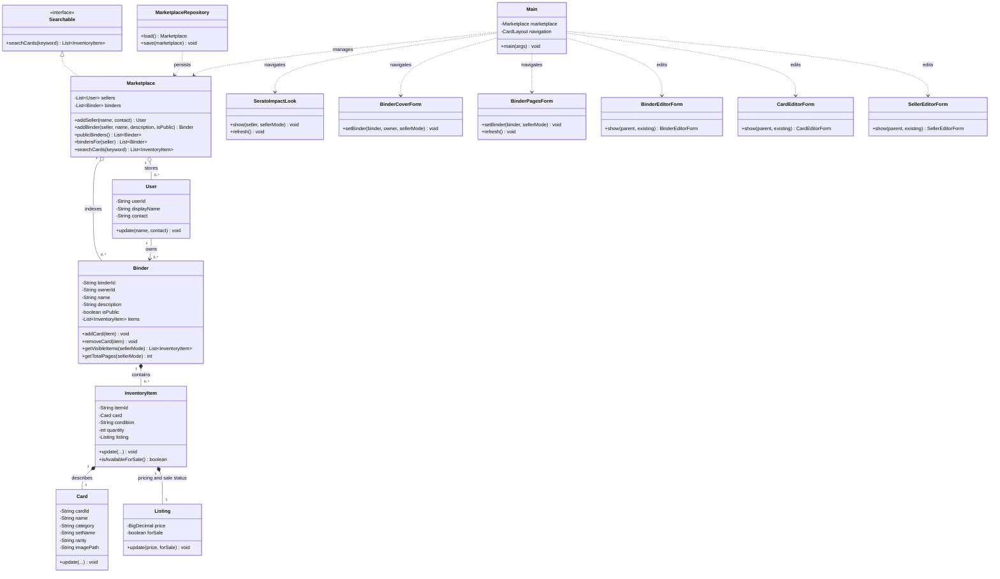

# Revised UML: Binder Marketplace Only

## Important notes

- Card is now a **concrete data class**. No combat or action-card inheritance is required to catalog cards.
- Card type/group is descriptive metadata (`category`); there is no `play()`, `takeDamage()`, dice, skill or summon method.
- InventoryItem owns a card description and a listing, and tracks stock and condition. A listing that is not marked for sale remains visible to the owner but hidden from buyers.
- Buyer and seller are **view modes** of the same local prototype. No buyer authentication, reservation, transaction, or checkout subsystem exists.
- Page number is derived from the ordered inventory, nine cards at a time. It is not stored as a separate entity.
